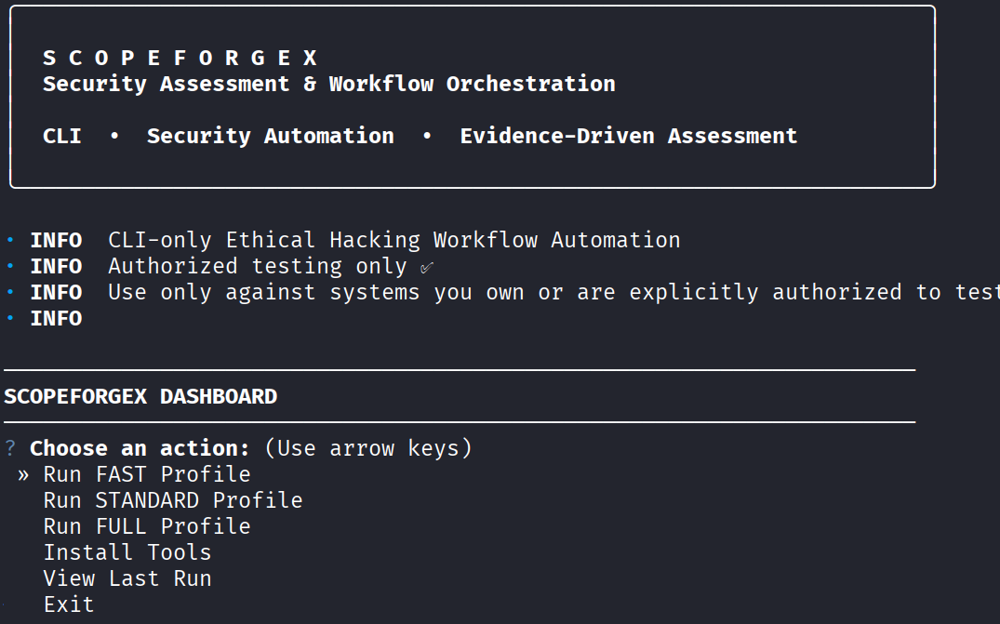
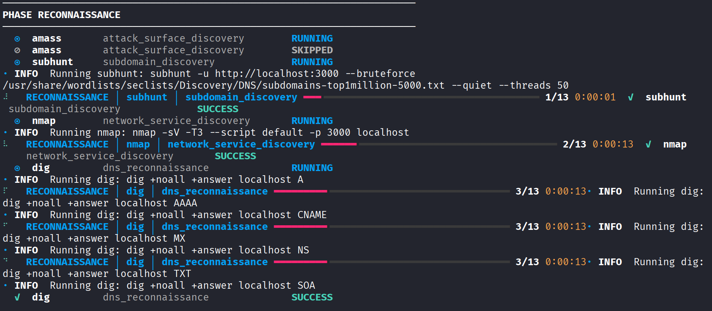
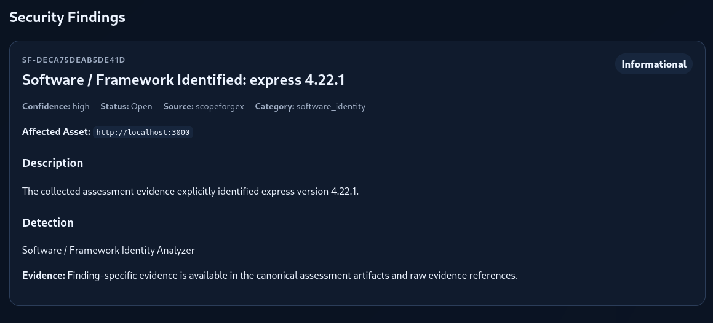
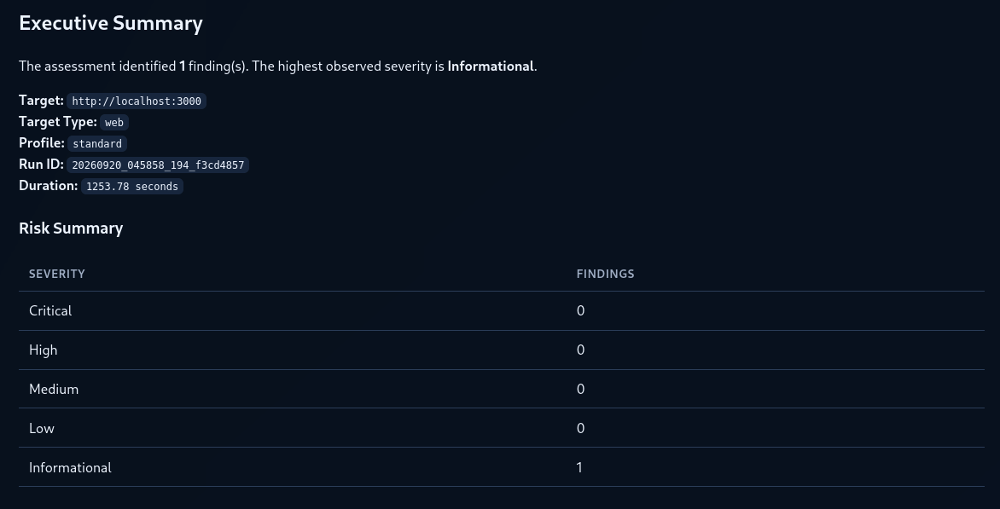
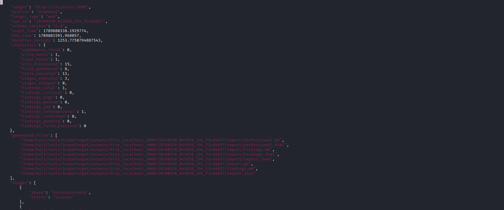

<div align="center">

# ScopeForgeX


A stage-based **cybersecurity workflow orchestration framework** for authorized security assessments, combining security-tool execution, structured evidence collection, finding normalization, correlation, vulnerability intelligence, and professional reporting.

</div>

---

## ✨ Highlights

- 🧭 **Stage-based assessment workflow**
- 🛠️ **19 security tools** integrated through canonical tool adapters
- 🎛️ **FAST, STANDARD, and FULL execution profiles**
- 🎯 **Target-aware tool selection and conditional execution**
- 🧾 **Structured execution results and evidence collection**
- 🔎 **Finding normalization, correlation, and deduplication**
- 🧠 **CVE, NVD, and KEV vulnerability intelligence**
- 🛡️ **Evidence sanitization before publication**
- 📊 **Professional HTML, Markdown, and JSON reporting**
- 🔗 **Subhunt integration for focused reconnaissance**
- 🕷️ **Wapiti-based web vulnerability assessment**
- ⏱️ **Configurable tool and workflow timeouts**
- 🧪 **Automated regression and integration testing**
- 📈 **Benchmark evidence for orchestration overhead**

---

## 📸 Demo

### Dashboard



*Interactive ScopeForgeX dashboard showing the assessment banner, authorization notice, and execution-profile selection.*

### Reconnaissance



*Reconnaissance-stage execution against an authorized local OWASP Juice Shop target.*

### Vulnerability Assessment



*Normalized vulnerability-assessment output and finding presentation.*

### Professional Report



*Professional assessment report showing the assessment summary and severity overview.*

### Machine-Readable Report



*Canonical JSON assessment output containing execution metadata, statistics, stages, findings, and generated artifacts.*

---

## Contents

- [✨ Highlights](#-highlights)
- [📸 Demo](#-demo)
- [✨ Why ScopeForgeX?](#-why-scopeforgex)
- [⚙️ Core Capabilities](#️-core-capabilities)
- [🏗️ Architecture](#️-architecture)
- [🔄 Assessment Workflow](#-assessment-workflow)
- [🎛️ Execution Profiles](#️-execution-profiles)
- [🧰 Supported Tools](#-supported-tools)
- [🎯 Target-Aware Execution](#-target-aware-execution)
- [🔗 Subhunt Integration](#-subhunt-integration)
- [🕷️ Wapiti Vulnerability Assessment](#️-wapiti-vulnerability-assessment)
- [🧠 Vulnerability Intelligence](#-vulnerability-intelligence)
- [📊 Reporting](#-reporting)
- [🔒 Evidence Safety](#-evidence-safety)
- [🚀 Quick Start](#-quick-start)
- [📦 Installation](#-installation)
- [💻 Usage](#-usage)
- [🧪 Local Juice Shop Example](#-local-juice-shop-example)
- [📈 Benchmark](#-benchmark)
- [⏱️ Runtime and Timeouts](#️-runtime-and-timeouts)
- [🧪 Testing](#-testing)
- [📁 Repository Structure](#-repository-structure)
- [🧠 Design Philosophy](#-design-philosophy)
- [⚠️ Current Limitations](#️-current-limitations)
- [🛣️ Roadmap](#-roadmap)
- [⚖️ Legal & Ethical Use](#️-legal--ethical-use)
- [📄 License](#-license)

---

## ✨ Why ScopeForgeX?

- Security tools are powerful individually, but a real assessment requires more than launching commands.

- ScopeForgeX provides an orchestration layer around security tooling so that an assessment can move through a consistent pipeline:

  ```text
  Target
   │
   ▼
  Scope & Authorization
   │
   ▼
  Reconnaissance
   │
   ▼
  Enumeration
   │
   ▼
  Vulnerability Assessment
   │
   ▼
  Validation / Exploitation
   │
   ▼
  Credential Assessment
   │
   ▼
  Finding Normalization
   │
   ▼
  Correlation & Deduplication
   │
   ▼
  Vulnerability Intelligence
   │
   ▼
  Reporting & Cleanup
  ```

- The project is designed to make tool execution **structured, observable, reproducible, and evidence-driven** rather than treating individual command-line tools as isolated scripts.

---

## ⚙️ Core Capabilities

| Capability | Description |
|---|---|
| Workflow orchestration | Coordinates security tools across assessment stages |
| Tool adapters | Provides a canonical interface for individual security tools |
| Execution results | Captures exit status, stdout, stderr, timing, metadata, and execution state |
| Target-aware execution | Selects or skips tools based on the target type and stage |
| Evidence collection | Converts raw tool output into structured observations |
| Finding normalization | Converts observations into canonical findings |
| Correlation | Associates related evidence and findings |
| Deduplication | Prevents duplicate findings from multiple sources |
| Vulnerability intelligence | Enriches applicable software findings with vulnerability data |
| Evidence sanitization | Prevents raw HTTP payloads from leaking into published reports |
| Reporting | Generates Markdown, HTML, and JSON assessment outputs |
| Profiles | Supports FAST, STANDARD, and FULL assessment profiles |
| Timeouts | Supports profile and tool-specific execution timeouts |
| Testing | Includes unit, regression, integration, and contract coverage |

---

## 🏗️ Architecture

- ScopeForgeX follows a layered pipeline in which tools produce execution results, collectors transform those results into structured observations, and the finding pipeline produces canonical security findings.

```text
┌───────────────────────────────────────────────┐
│                 ScopeForgeX CLI               │
└───────────────────────┬───────────────────────┘
                        │
                        ▼
┌───────────────────────────────────────────────┐
│              Workflow Engine                  │
│     Profile + Stage + Target Selection        │
└───────────────────────┬───────────────────────┘
                        │
                        ▼
┌───────────────────────────────────────────────┐
│                Tool Registry                  │
│             ToolAdapter / ToolBase            │
└───────────────────────┬───────────────────────┘
                        │
                        ▼
┌───────────────────────────────────────────────┐
│                Tool Executor                  │
│       Command construction + execution        │
└───────────────────────┬───────────────────────┘
                        │
                        ▼
┌───────────────────────────────────────────────┐
│               ExecutionResult                 │
│       stdout / stderr / status / timing       │
└───────────────────────┬───────────────────────┘
                        │
                        ▼
┌───────────────────────────────────────────────┐
│                  Collectors                   │
│       Tool output → structured observations   │
└───────────────────────┬───────────────────────┘
                        │
                        ▼
┌───────────────────────────────────────────────┐
│              Finding Normalizer               │
└───────────────────────┬───────────────────────┘
                        │
                        ▼
┌───────────────────────────────────────────────┐
│          Correlation / Deduplication          │
└───────────────────────┬───────────────────────┘
                        │
                        ▼
┌───────────────────────────────────────────────┐
│          Vulnerability Intelligence           │
│          CPE / NVD / CVE / KEV enrichment     │
└───────────────────────┬───────────────────────┘
                        │
                        ▼
┌───────────────────────────────────────────────┐
│                Reporting Layer                │
│        HTML / Markdown / JSON / cleanup       │
└───────────────────────────────────────────────┘
```

---

### Execution Contract

- The canonical tool flow is:

  ```text
  Tool Adapter
      │
      ▼
  ExecutionResult
      │
      ▼
  Raw Evidence
      │
      ▼
  Collector
      │
      ▼
  Structured Observations
      │
      ▼
  Finding Normalizer
      │
      ▼
  Finding
      │
      ▼
  Correlation / Deduplication
      │
      ▼
  Report
  ```

- The architecture deliberately separates:

  - command execution
  - raw execution evidence
  - evidence interpretation
  - finding creation
  - finding correlation
  - vulnerability enrichment
  - publication

## Assessment Workflow

- ScopeForgeX follows a structured seven-stage assessment lifecycle:

  ```text
  0. Scope & Authorization
          ↓
  1. Reconnaissance
          ↓
  2. Enumeration
          ↓
  3. Vulnerability Assessment
          ↓
  4. Vulnerability Validation
          ↓
  5. Post Exploitation
          ↓
  6. Reporting & Cleanup
  ```

### Stage 0 — Scope & Authorization

- Defines the target and authorization state before assessment execution.
- Prevents execution without explicit authorization.
- Establishes the assessment context used by the workflow.

### Stage 1 — Reconnaissance

- Discovers domains, subdomains, DNS information, HTTP services, technologies, and URLs.
- Performs passive and active reconnaissance according to the selected execution profile.
- Uses target-aware logic to avoid inappropriate tools for IP-only targets.

### Stage 2 — Enumeration

- Identifies open ports, services, routes, endpoints, and additional attack-surface information.
- Correlates results from multiple enumeration tools.
- Produces structured observations for downstream analysis.

### Stage 3 — Vulnerability Assessment

- Performs vulnerability-oriented security testing against discovered attack surfaces.
- Uses Wapiti, Nikto, and testssl.sh where applicable.
- Converts tool output into structured security observations.

### Stage 4 — Vulnerability Validation

- Provides validation-oriented security tooling for identified vulnerabilities.
- Supports controlled validation rather than treating scanner output as automatically confirmed exploitation.
- Preserves execution evidence for reporting and analysis.

### Stage 5 — Post Exploitation

- Provides controlled credential-assessment capabilities.
- Supports authorized password and credential testing workflows.
- Uses Hydra and Hashcat according to the selected profile and target context.

### Stage 6 — Reporting & Cleanup

- Correlates and normalizes collected security observations.
- Generates structured findings and security reports.
- Performs evidence sanitization before publication.
- Produces JSON and human-readable reporting artifacts.
- Includes CVE and KEV intelligence where applicable.
- Preserves raw execution evidence internally while preventing sensitive raw HTTP material from leaking into published reports.

---

## Execution Profiles

- ScopeForgeX provides three execution profiles:

| Profile | Purpose | Selected Tools |
|---|---|---:|
| `FAST` | Lightweight assessment | 3 |
| `STANDARD` | Balanced assessment | 13 |
| `FULL` | Comprehensive assessment | 17 |

### FAST

- Designed for rapid initial assessment.
- Uses a minimal toolset to reduce execution time.
- Suitable for quick reconnaissance and attack-surface discovery.

### STANDARD

- Default balanced assessment profile.
- Combines reconnaissance, enumeration, vulnerability assessment, and supporting security intelligence.
- Designed to provide useful coverage without the complete runtime of the FULL profile.

### FULL

- Maximum supported assessment coverage.
- Enables additional active reconnaissance, vulnerability, validation, and credential-assessment capabilities.
- Intended for deeper authorized assessments.

### Profile Selection

```bash
scopeforgex --profile fast --target <target> --authorized
scopeforgex --profile standard --target <target> --authorized
scopeforgex --profile full --target <target> --authorized
```

---

## Supported Tools

- ScopeForgeX currently integrates **19 security tools** across its assessment lifecycle.

| Tool | Primary Capability | Stage |
|---|---|---|
| Amass | Domain reconnaissance | Reconnaissance |
| Subhunt | Subdomain & virtual-host enumeration | Reconnaissance |
| Nmap | Port & service enumeration | Enumeration |
| dig | DNS enumeration | Enumeration |
| httpx | HTTP service discovery & probing | Enumeration |
| Katana | Web crawling & URL discovery | Enumeration |
| ffuf | Content & endpoint discovery | Enumeration |
| WhatWeb | Technology identification | Enumeration |
| Kiterunner | API route discovery | Enumeration |
| jsluice | JavaScript analysis & endpoint extraction | Enumeration |
| Wapiti | Web vulnerability assessment | Vulnerability Assessment |
| Nikto | Web server security assessment | Vulnerability Assessment |
| testssl.sh | TLS/SSL security assessment | Vulnerability Assessment |
| sqlmap | SQL injection validation | Vulnerability Validation |
| Dalfox | XSS testing & validation | Vulnerability Validation |
| jwt_tool | JWT security testing | Vulnerability Validation |
| SSTImap | Server-side template injection testing | Vulnerability Validation |
| Hydra | Online credential testing | Post Exploitation |
| Hashcat | Offline password recovery | Post Exploitation |

> Tool availability and execution are controlled by the selected profile and target-aware conditions.

---

## Target-Aware Execution

- ScopeForgeX does not blindly execute every integrated tool against every target.

- Tool execution can depend on:

  - Target type.
  - Target protocol.
  - Target hostname.
  - IP address versus domain.
  - Selected execution profile.
  - Tool-specific requirements.
  - Explicit authorization state.

- For example, **Amass** is conditionally executed for applicable domain targets and skipped for targets where domain reconnaissance is not appropriate.

- This prevents unnecessary tool execution and keeps the assessment workflow aligned with the target.

---

## Subhunt Integration

- ScopeForgeX integrates **Subhunt** as its dedicated subdomain and virtual-host enumeration capability.

- Subhunt provides:

  - DNS-based subdomain enumeration.
  - HTTP virtual-host enumeration.
  - DNS-over-HTTPS resolver failover.
  - Wildcard-aware DNS handling.
  - HTTP baseline fingerprinting.
  - Catch-all filtering.
  - Structured evidence-rich findings.
  - Quiet and JSON output modes.

- ScopeForgeX consumes Subhunt's execution output through a dedicated adapter and collector rather than treating its raw output as a final finding.

### Subhunt Execution Flow

```text
Target
  ↓
Subhunt Adapter
  ↓
Subhunt Execution
  ↓
ExecutionResult
  ↓
Subhunt Collector
  ↓
Structured Observations
  ↓
Finding Normalization
  ↓
Correlation / Reporting
```

---

## Wapiti Integration

- Wapiti is ScopeForgeX's active web vulnerability assessment engine.

- It is integrated through:

  - `scopeforgex/tools/stage3_vuln.py`
  - `scopeforgex/collectors/wapiti.py`

- The integration converts Wapiti output into ScopeForgeX's structured observation model while preserving the original execution evidence internally.

- Wapiti replaced the previous Nuclei integration in the active ScopeForgeX source and workflow.

---

## Vulnerability Intelligence

- ScopeForgeX enriches software and vulnerability observations with security intelligence where applicable.

- The intelligence pipeline can incorporate:

  ```text
  Software Detection
         ↓
  CPE Identification
         ↓
  CVE Lookup
         ↓
  NVD Enrichment
         ↓
  KEV Correlation
         ↓
  Finding / Report
  ```

- Software assessments retain:

  - Software name.
  - Version.
  - Vendor.
  - CPE.
  - Confidence.
  - Applicable CVEs.
  - KEV status.
  - Supporting evidence.

- CVE information is incorporated into findings without automatically changing finding severity based on confidence.

---

## Reporting

- ScopeForgeX generates structured assessment artifacts containing information such as:

  - Target.
  - Profile.
  - Run ID.
  - Execution duration.
  - Tool execution status.
  - Discovered hosts.
  - Discovered URLs.
  - Software assessments.
  - Findings.
  - Severity distribution.
  - CVE information.
  - KEV information.
  - Stage execution status.
  - Warnings and errors.
  - Generated report files.

- The reporting pipeline separates:

  - Internal execution evidence.
  - Structured observations.
  - Normalized findings.
  - Published report data.

- This allows detailed execution evidence to remain available for analysis without unnecessarily exposing raw HTTP payloads in published reports.

## Evidence Safety

- ScopeForgeX follows an evidence-driven assessment model.

- The framework separates raw tool execution data from structured security findings:

  ```text
  Tool Execution
        ↓
  Raw Evidence
        ↓
  Collector
        ↓
  Structured Observations
        ↓
  Finding Normalization
        ↓
  Correlation / Deduplication
        ↓
  Published Report
  ```

### Raw Execution Evidence

- Raw execution evidence is retained internally to support:

  - Troubleshooting.
  - Validation.
  - Reproducibility.
  - Evidence review.
  - Security assessment analysis.

- Execution results can contain:

  - Standard output.
  - Standard error.
  - Exit codes.
  - Execution metadata.
  - Command information.
  - Tool-specific evidence.

### Published Evidence

- Published reports use sanitized evidence rather than blindly exposing raw tool output.

- The publication layer removes or prevents propagation of sensitive raw HTTP material such as:

  - Raw HTTP request bodies.
  - Raw HTTP response bodies.
  - Raw headers.
  - Raw requests.
  - Raw responses.

- This ensures that detailed execution evidence can remain available internally without unnecessarily leaking raw HTTP payloads into published reports.

### Evidence Contract

- ScopeForgeX maintains an explicit contract between:

  ```text
  Execution Evidence
          ↓
  Collected Observations
          ↓
  Normalized Findings
          ↓
  Published Report
  ```

- This prevents tool-specific output formats from becoming the public reporting model.

---

## Quick Start

### 1. Clone the Repository

```bash
git clone git@github.com:VikashChoudhary-04/ScopeForgeX.git
cd ScopeForgeX
```

### 2. Install Dependencies

- Run the canonical installer:

  ```bash
  sudo bash install.sh
  ```

- The installer provisions the required system packages, language runtimes, security tools, source-based tools, and supporting dependencies used by ScopeForgeX.

### 3. Verify the Installation

- Check the CLI:

  ```bash
  scopeforgex --help
  ```

- Check the installed security tools:

  ```bash
  scopeforgex --install-check
  ```

### 4. Run an Authorized Assessment

```bash
scopeforgex --profile standard --target <target> --authorized
```

- Replace `<target>` with an explicitly authorized assessment target.

---

## Installation

- ScopeForgeX is designed for Linux-based security assessment environments.

- The canonical installation workflow provisions dependencies for the integrated toolchain.

### Base Dependencies

- The installation process includes dependencies such as:

  - Python 3.
  - Python package tooling.
  - Python virtual-environment support.
  - Go.
  - Rust/Cargo.
  - Git.
  - Build tools.

### Security Tools

- The installer provisions the integrated security toolchain, including:

  - Amass.
  - Nmap.
  - dig.
  - ffuf.
  - WhatWeb.
  - Nikto.
  - testssl.sh.
  - SQLmap.
  - SSTImap.
  - Hydra.
  - Hashcat.
  - Wapiti.
  - SecLists.

- Additional tools are installed through Go, Cargo, or source-based installation where required.

### Source-Based Tools

- Some integrations are installed from their source repositories, including:

  - Kiterunner.
  - jwt_tool.
  - Subhunt.

- The installation workflow also configures the required runtime environments and executable paths for these integrations.

---

## Usage

- ScopeForgeX can be executed through its CLI entry point.

### FAST Profile

```bash
scopeforgex --profile fast --target <target> --authorized
```

### STANDARD Profile

```bash
scopeforgex --profile standard --target <target> --authorized
```

### FULL Profile

```bash
scopeforgex --profile full --target <target> --authorized
```

### Python Module Invocation

- The framework can also be invoked directly as a Python module:

```bash
python3 -m scopeforgex --profile standard --target <target> --authorized
```

### Authorization Requirement

- ScopeForgeX is intended for authorized security assessments only.

- The `--authorized` flag explicitly confirms that the supplied target is within an authorized assessment scope.

- Do not use ScopeForgeX against systems you do not own or have explicit permission to test.

---

## Runtime and Timeout Handling

- ScopeForgeX provides profile-controlled execution timeouts.

- The timeout configuration flows through the workflow execution stack:

```text
profiles.yaml
      ↓
WorkflowEngine
      ↓
ToolExecutor
      ↓
ToolContext
      ↓
Tool Adapter
      ↓
Command Execution
```

- The configured profile timeout becomes the default tool execution timeout.

- Individual tools can override the default when required.

- This allows long-running security tools to operate within controlled execution boundaries without changing the global workflow configuration.

---

## Local Juice Shop Example

- ScopeForgeX can be tested against intentionally vulnerable applications running in a local environment.

- The project was validated against OWASP Juice Shop running locally at:

  ```text
  http://localhost:3000
  ```

### Start Juice Shop

- Ensure the application is available before starting the assessment.

Verify connectivity:

  ```bash
  curl -I http://localhost:3000
  ```

- Expected response:

  ```text
  HTTP/1.1 200 OK
  ```

### Run STANDARD Assessment

```bash
scopeforgex --profile standard --target http://localhost:3000 --authorized
```

- The workflow performs the applicable stages and executes the tools enabled by the STANDARD profile.

### Reference Run

- A documented STANDARD reference run against the local Juice Shop instance used:

  ```text
  Target:   http://localhost:3000
  Profile:  STANDARD
  Run ID:   20260920_045858_194_f3cd4857
  ```

- The reference execution selected 13 logical tools.

- Target-aware execution skipped tools that were not applicable to the local target.

- The resulting assessment produced structured reporting artifacts including:

  - Tool execution status.
  - Discovered URLs.
  - Host information.
  - Software identification.
  - Security findings.
  - CVE information.
  - Stage status.
  - Execution metadata.

### Example Finding

- The reference run identified the Express framework:

  ```text
  Software / Framework Identified: express 4.22.1
  ```

- The finding was classified as:

  ```text
  Severity:    Informational
  Confidence:  High
  Status:      Open
  Category:    software_identity
  ```

- The assessment also generated a software assessment for Express 4.22.1 with its associated CPE and vulnerability-intelligence lookup status.

---

## Generated Reports

- Assessment runs generate structured output under the `outputs/` directory.

- A typical run produces artifacts for:

  - Assessment metadata.
  - Findings.
  - JSON reporting.
  - Human-readable reporting.
  - Execution information.
  - Stage results.

- The generated report provides a consolidated view of the assessment while preserving the underlying execution evidence separately.

## Benchmark

- ScopeForgeX includes benchmark evidence against a real web application target to measure workflow overhead independently from the underlying security tools.

### STANDARD Profile Benchmark

- Benchmark target:

  ```text
  https://warrantyindia.com/
  ```

- The ScopeForgeX reference run used:

  ```text
  Reference Run:
  1060.6487560272217 seconds
  ```

- An independent Python baseline was executed five times.

- Four runs were valid:

  ```text
  1060.7696018240003 s
  984.8302501480002 s
  1060.8447160859996 s
  994.6224477469987 s
  ```

- One run was excluded because Nikto terminated with a SIGPIPE condition.

### Benchmark Results

| Metric | Result |
|---|---:|
| ScopeForgeX reference | 1060.6488 s |
| Baseline mean | 1025.2668 s |
| Baseline minimum | 984.8303 s |
| Baseline maximum | 1060.8447 s |
| Absolute difference | 35.3820 s |
| Relative overhead | ~3.45% |

- The measured ScopeForgeX overhead was approximately **3.45%** relative to the valid independent baseline mean.

- The benchmark is intended as engineering evidence of orchestration overhead rather than as a general claim about assessment speed across all environments or targets.

---

## Testing

- ScopeForgeX uses automated regression testing to validate the framework's architecture, integrations, reporting contracts, and execution behavior.

- Run the complete test suite with:

  ```bash
  pytest -q
  ```

- Compile-check the Python source tree with:

  ```bash
  python3 -m compileall scopeforgex
  ```

- Check Git whitespace errors with:

  ```bash
  git diff --check
  ```

### Test Coverage Areas

- The test suite covers areas including:

  - Tool adapters.
  - Tool execution.
  - Execution result handling.
  - Profile selection.
  - Conditional tool execution.
  - Subhunt integration.
  - Wapiti integration.
  - Kiterunner integration.
  - Executable resolution.
  - Collector behavior.
  - Structured observations.
  - Finding normalization.
  - Correlation and deduplication.
  - Software assessment lifecycle.
  - CVE reporting.
  - Report generation.
  - JSON export.
  - Evidence sanitization.
  - Stage 6 reporting.
  - Regression behavior.

### Integration Validation

- Tool-specific tests are maintained alongside the framework components they validate.

- Examples include:

  ```text
  tests/test_subhunt.py
  tests/test_wapiti.py
  tests/test_kiterunner_tool.py
  tests/test_executable_resolution.py
  tests/test_software_assessment.py
  tests/test_stage6_report_projection.py
  tests/test_regression_baseline.py
  ```

- The project also uses focused regression tests for previously identified behavioral issues to prevent regressions during architectural changes.

---

## Repository Structure

- The repository follows a modular architecture separating workflow orchestration, tool integrations, collectors, reporting, configuration, and tests.

  ```text
  ScopeForgeX/
  ├── scopeforgex/
  │   ├── cli.py
  │   ├── dashboard.py
  │   ├── ui.py
  │   ├── workflow.py
  │   ├── runner.py
  │   ├── executor.py
  │   ├── context.py
  │   │
  │   ├── config/
  │   │   └── profiles.yaml  
  │   │
  │   ├── tools/
  │   │   ├── base.py
  │   │   ├── stage1_recon_web.py
  │   │   ├── stage1_recon_network.py
  │   │   ├── stage2_enum.py
  │   │   ├── stage3_vuln.py
  │   │   ├── stage4_validation.py
  │   │   └── stage5_credential.py
  │   │
  │   ├── collectors/
  │   │   ├── base.py
  │   │   ├── subhunt.py
  │   │   └── wapiti.py
  │   │
  │   ├── stages/
  │   │   ├── stage0_scope.py
  │   │   ├── stage6_report_cleanup.py
  │   │   └── shared.py
  │   │
  │   └── reporting/
  │       └── ...
  │
  ├── tests/
  │   ├── ...
  │   └── ...
  │
  ├── docs/
  │   └── screenshots/
  │
  ├── outputs/
  │   └── ...  
  │  
  ├── install.sh
  ├── README.md
  └── LICENSE
  ```

- The exact repository contents may evolve as the framework develops, but the architecture maintains clear separation between:

  - CLI and user interaction.
  - Workflow orchestration.
  - Tool adapters.
  - Evidence collection.
  - Structured findings.
  - Reporting.
  - Configuration.
  - Automated testing.

---

## Design Philosophy

- ScopeForgeX is built around a simple architectural principle:

  > **One capability → one primary tool → structured finding → evidence → correlation → report.**

- The framework is intentionally designed as a **CLI-based security assessment orchestrator**, not as a fully autonomous penetration-testing system.

### Modular Tool Integration

- Each security capability is implemented through a dedicated tool integration.

- This keeps tool-specific command construction and execution behavior isolated from the workflow engine.

### Structured Evidence

- Tool output is not treated as a final report.

- Instead:

  ```text
  Tool Output
      ↓
  ExecutionResult
      ↓
  Collector
      ↓
  Observation
      ↓
  Finding
  ```

- This allows different tools to produce normalized security data without forcing the reporting layer to understand every tool's native output format.

### Evidence-Driven Reporting

- Findings are expected to retain supporting evidence and provenance.

- This provides traceability between:

  - The tool that produced the evidence.
  - The detection method.
  - The target.
  - The observation.
  - The normalized finding.
  - The final report.

### Separation of Concerns

- ScopeForgeX separates:

  - Scope validation.
  - Tool execution.
  - Evidence collection.
  - Finding normalization.
  - Correlation.
  - Vulnerability intelligence.
  - Reporting.
  - Cleanup.

- This makes individual components easier to test, replace, and extend.

### Explicit Authorization

- ScopeForgeX is designed for authorized security testing.

- The framework does not attempt to remove the responsibility of the operator to define and verify assessment scope.

---

## Architectural Principles

- The framework follows several core principles:

### 1. Canonical Execution Model

- Tool execution flows through a common execution contract instead of allowing every integration to define its own result format.

### 2. Tool Adapter Isolation

- Tool-specific command construction remains inside the corresponding adapter.

### 3. Structured Observations

- Collectors transform tool output into structured observations before findings are generated.

### 4. Finding Normalization

- Findings use a consistent representation regardless of which tool detected the underlying issue.

### 5. Correlation and Deduplication

- Multiple observations referring to the same security condition can be correlated before reporting.

### 6. Evidence Preservation

- Execution evidence remains available for investigation and troubleshooting while published evidence is sanitized.

### 7. Profile-Driven Execution

- FAST, STANDARD, and FULL profiles control the breadth of the assessment.

### 8. Target-Aware Execution

- Tools are executed only when their capabilities are applicable to the target and assessment context.

## Limitations

- ScopeForgeX is an orchestration framework and does not attempt to replace the expertise of a professional penetration tester.

- Important limitations include:

  - Tool results depend on the capabilities and configuration of the underlying security tools.
  - Assessment quality depends on target accessibility, network conditions, authentication state, and tool configuration.
  - Automated findings may require manual validation.
  - Not every vulnerability class can be reliably identified through automated assessment.
  - Exploitation and post-exploitation activities require appropriate operator judgment and authorization.
  - Runtime can vary significantly depending on target behavior and tool execution time.
  - External vulnerability intelligence depends on the availability and accuracy of external vulnerability databases.
  - Target-aware execution can intentionally skip tools when their capabilities are not applicable to the target.

- ScopeForgeX should therefore be treated as an assessment orchestration and evidence-management framework rather than a replacement for manual security analysis.

---

## Roadmap

- Potential future improvements include:

  - Expanded API security assessment capabilities.
  - Additional vulnerability validation workflows.
  - Improved authentication-aware testing.
  - Expanded post-exploitation workflows.
  - Additional security intelligence integrations.
  - More advanced finding correlation.
  - Expanded report formats.
  - Improved execution scheduling and concurrency.
  - Additional tool adapters and collectors.
  - Expanded regression and integration coverage.
  - More detailed assessment metrics and benchmarking.

- The roadmap is intentionally focused on extending the existing architecture without compromising the framework's structured execution and evidence model.

---

## Legal & Ethical Use

- ScopeForgeX is intended **only for authorized security assessments**.

- Use the framework only when you have explicit permission to assess the target system, application, network, or infrastructure.

- Do not use ScopeForgeX to:

  - Access systems without authorization.
  - Attack third-party infrastructure.
  - Perform unauthorized vulnerability scanning.
  - Attempt unauthorized credential attacks.
  - Exploit systems without permission.
  - Disrupt services or infrastructure.
  - Access, modify, or exfiltrate data without authorization.

- The operator is responsible for:

  - Defining the assessment scope.
  - Obtaining appropriate authorization.
  - Following applicable laws and regulations.
  - Respecting rules of engagement.
  - Handling discovered security information responsibly.
  - Limiting testing to authorized targets.

- The `--authorized` flag is an explicit operator confirmation and does not itself grant permission to test a target.

---

## License

- ScopeForgeX is released under the MIT License.

- See the [`LICENSE`](LICENSE) file for the complete license text.

---

## Project

- **ScopeForgeX** is an offensive security assessment automation framework focused on:

  - Structured security workflows.
  - CLI-based execution.
  - Modular security-tool integration.
  - Evidence-driven findings.
  - Vulnerability intelligence.
  - Correlation and deduplication.
  - Security assessment reporting.

- The project is designed to make authorized security assessments more structured, repeatable, and evidence-driven without attempting to fully automate the judgment of a penetration tester.

---

<div align="center">

**Built for authorized security testing and security engineering.**

**ScopeForgeX**

*Security Assessment & Workflow Orchestration*

</div>
